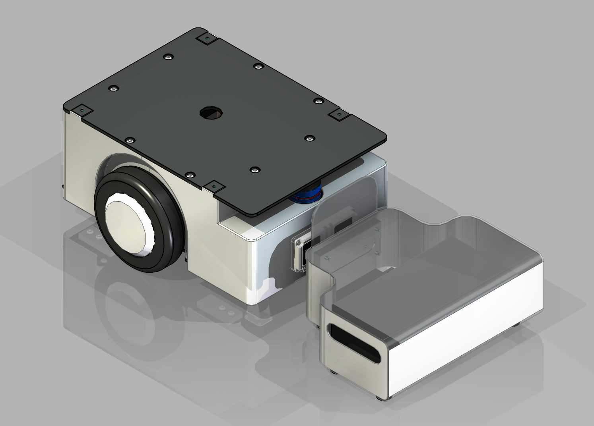

### 轻型 AGV 小车

> 本项目设计了一款**轻型 AGV 小车**，作为迎宾机器人的移动底盘。整车尺寸 **517×468.5×242mm**，采用非承载式底盘 + 悬挂设计，注重结构紧凑性和集成度。

## 目录结构
- `Body/` -存放主要内容
- `Note`  -存放零时想法

## 使用方法（包括INDEX）

### 项目效果图

*轻型 AGV 小车 - 实物渲染效果*

### 设计创新点

- **顶部空间优化**：底部螺丝直接与外壳连接，显著提升安装便利性
- **悬挂传力设计**：悬挂直接承力，底盘不承担额外纵向拉力，受力更合理
- **高集成度布局**：内部结构紧凑，大幅减少空间浪费
- **非承载式底盘**：提升整体结构合理性与可靠性

### 主要参数

- **整车尺寸**：517mm（长）× 468.5mm（宽）× 242mm（高）
- **设计目标**：轻型、紧凑、高集成度迎宾机器人底盘

### 设计难点与后续规划

- 当前尺寸略超预期（横向长度超过 500mm）
- 电池盒装配存在间隙，需进一步优化防碰撞
- 内壳拼接处螺栓安装不便
- 下一步计划：继续迭代模型、完成第二版 BOM 表（机械+电气）

## 保留内容

### 学习许可与权利保留

- 本项目允许个人、学校和研究者进行非商业性的学习、研究和引用。
- 未经著作权人书面许可，不得将项目内容用于商业开发、产品制造、商业服务、商业宣传、投标交付、毕业设计成品交付或再授权。
- 不得删除作者、来源、版本历史和第三方许可证声明，不得将本项目或其衍生成果宣称为与作者无关的原创项目。
- 软件源码适用 [PolyForm Noncommercial 1.0.0](https://polyformproject.org/licenses/noncommercial/1.0.0/)；机械模型、PCB、原理图、图片、文档、Unity 工程和其他非软件资料适用 [CC BY-NC-ND 4.0](https://creativecommons.org/licenses/by-nc-nd/4.0/)。
- SE、SW、STEP/STP 及其他三维模型仅允许个人或学校进行非商业学习、评审和研究；未经著作权人书面许可，不得用于加工、打样、制造、销售、量产、投标、产品交付、商业宣传、改作或再授权。
- 第三方组件、模板、元件库、外购件模型和工具仍受其原始许可证约束；本声明不扩大作者对第三方内容的权利。

商业使用、产品化、公司内部长期使用、转让或排他性授权需另行取得著作权人的书面许可。